# GraphLab User Guide

GraphLab is an interactive, paper-notebook style graph theory playground and educational laboratory. It enables you to interactively draw directed or undirected, weighted or unweighted graphs directly on an engineering paper canvas, step through classic graph algorithms with animated visualizations, and inspect the algorithm state in real time.

---

## 1. Getting Started & How to Open

### 1.1 Opening the Playground
GraphLab's playground is entirely client-side and requires no build steps or heavy dependencies:
- Simply open [`frontend/index.html`](file:///c:/Users/Tanishk/OneDrive/Desktop/Graph_Lab-1/frontend/index.html) in any modern web browser (Google Chrome, Microsoft Edge, Firefox, or Safari).
- Or serve it using any static HTTP server (for example: `npx serve frontend` or `python -m http.server -d frontend 3000`).

### 1.2 Starting the Backend API (Optional)
The core library contains a Spring Boot REST API skeleton in `GraphTheoryEngineAPI`. To start it:
```powershell
cd GraphTheoryEngineAPI
mvn spring-boot:run
```
*Note:* The playground UI in `frontend/` runs fully self-contained in the browser; starting the API is not required to use the playground.

---

## 2. Interactive Graph Creation & Controls

| Action | How to Perform |
|---|---|
| **Add a Node** | Click on any empty area of the graph paper canvas. Nodes are automatically named alphabetically (`A`, `B`, `C`, ... up to `Z`). |
| **Draw an Edge** | Click and drag with your mouse/pointer from a source node to a destination node, then release. |
| **Set Start Node** | Click directly on a node (without dragging). The node is marked with the label `start`. |
| **Set Target Node** | Shift-click directly on a node. The node is marked with the label `target`. |
| **Weighted Mode** | Toggle the **weighted** checkbox. When checked, creating an edge automatically pops up a weight input bubble. Weight defaults to 1 when unweighted. |
| **Entering Edge Weight** | In the weight popup, type any numeric value (decimals and negative numbers like `-3` or `2.5` are fully supported). Press **Enter** or click **Set weight** to confirm, or press **Escape** to cancel edge creation. |
| **Edit Edge Weight** | Click directly on the circular weight bubble located along an edge to open the weight editor popup. |
| **Delete an Edge** | Shift-click directly on the circular weight bubble of the edge. |
| **Erase Node Mode** | Click the **Erase node** button in the control bar. When active, clicking any node deletes it along with all incident edges. Click **Erase node** again to return to drawing mode. |
| **Directed Mode** | Toggle the **directed** checkbox. When checked, edges are drawn with directional arrows (`A -> B`). When unchecked, edges are bidirectional. |
| **Pen Speed** | Drag the **pen speed** slider (1 to 10). Level 1 creates slow, step-by-step animations for learning; Level 10 finishes multi-pass algorithms almost instantly. |
| **Stop** | Click the **Stop** button to interrupt any running algorithm animation immediately. |
| **Clear Paper** | Click the **Clear paper** button to reset the entire canvas to a blank page. |
| **Switch Theme** | Click the **Switch to dark** / **Switch to bright** button to toggle between the blueprint dark theme and clean light notebook paper. |

---

## 3. Algorithm Guide

### 3.1 Breadth-First Search (BFS)
- **What it does:** Explores the graph layer by layer, finding the path with the fewest hops (edges) from the start node to all reachable nodes.
- **Required settings:** Set **start** (and optionally **target**). Edge weights are ignored (treated as 1 hop).
- **Execution steps:** Click the **BFS** button.
- **Visual indicators:**
  - Nodes currently in the FIFO queue are outlined with dashed red borders.
  - Visited nodes turn yellow (`done`).
  - The final shortest-hop path to the target is highlighted with thick pink/red lines.
- **Reading panels:**
  - **Notes panel:** Displays "Queue (first in, first out)" and the active items waiting in the queue.
  - **Pen's log:** Shows each visit and queue state, concluding with `Path: A > B > D > F`.
- **Reference Graph Example:**
  - Start `A`, Target `F`.
  - Visited order: `A, B, C, D, E, F`.
  - Output path: `Path: A > B > D > F` (3 hops).
  - Screenshot:
    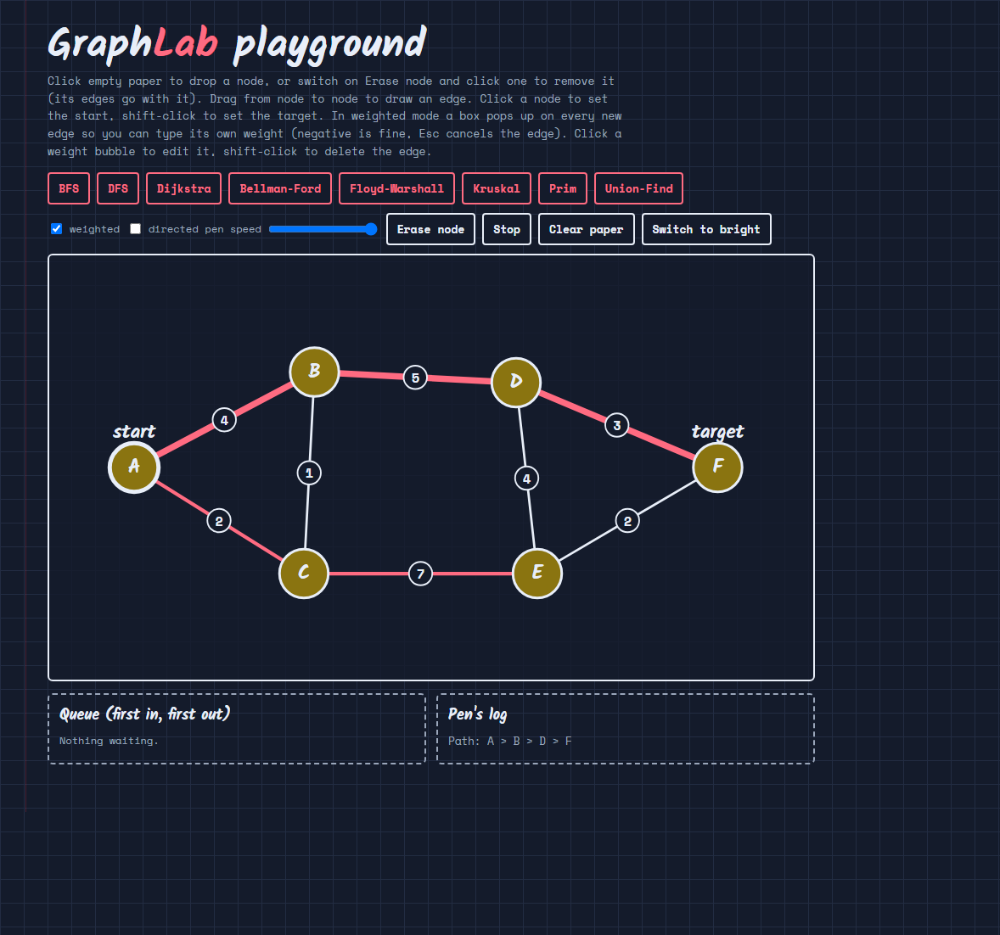

---

### 3.2 Depth-First Search (DFS)
- **What it does:** Explores as deep as possible along each branch before backtracking, discovering reachable subgraphs.
- **Required settings:** Set **start** (and optionally **target**).
- **Execution steps:** Click the **DFS** button.
- **Visual indicators:**
  - Nodes currently on the call stack are outlined.
  - Visited nodes turn yellow.
  - Discovered path to the target is highlighted.
- **Reading panels:**
  - **Notes panel:** Displays "Stack (last in, first out)" showing vertices waiting on the stack.
  - **Pen's log:** Traces the dive into each vertex and logs the final path found.
- **Reference Graph Example:**
  - Start `A`, Target `F`.
  - Visited order: `A, B, C, E, D, F`.
  - Output path: `Path: A > B > C > E > D > F`.
  - Screenshot:
    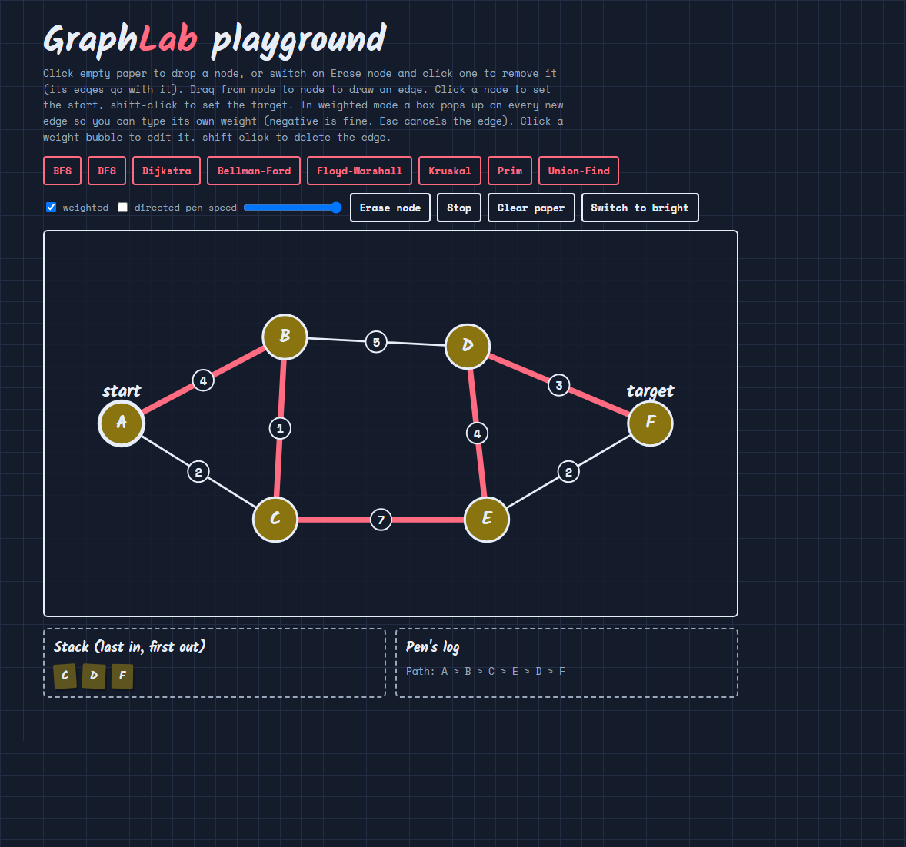

---

### 3.3 Dijkstra's Shortest Path
- **What it does:** Finds the optimal minimum-cost path from the start node to all reachable nodes in a graph with non-negative edge weights.
- **Required settings:** Set **start** and **target**. Graph can be directed or undirected. All edge weights must be non-negative ($\ge 0$).
- **Execution steps:** Click the **Dijkstra** button.
- **Visual indicators:**
  - Candidate nodes currently being considered show dashed borders.
  - Confirmed settled nodes turn yellow.
  - Settled shortest-path tree edges are drawn in solid red.
  - The final optimal path from `start` to `target` is highlighted in thick pink/red.
- **Reading panels:**
  - **Notes panel:** "Distance table (best known so far)" displays sticky notes for each node with its settled distance (e.g., `A=0`, `B=3`, `C=2`, `D=8`, `E=9`, `F=11`).
  - **Pen's log:** Logs each node locked in at its optimal distance, finishing with the final path: `Path: A > C > B > D > F`.
- **Reference Graph Example:**
  - Start `A`, Target `F`.
  - Settled distances: `A=0, C=2, B=3, D=8, E=9, F=11`.
  - Shortest path: `A > C > B > D > F` with total weight $2 + 1 + 5 + 3 = 11$. (Tie with `A > C > E > F` of cost 11).
  - Screenshot:
    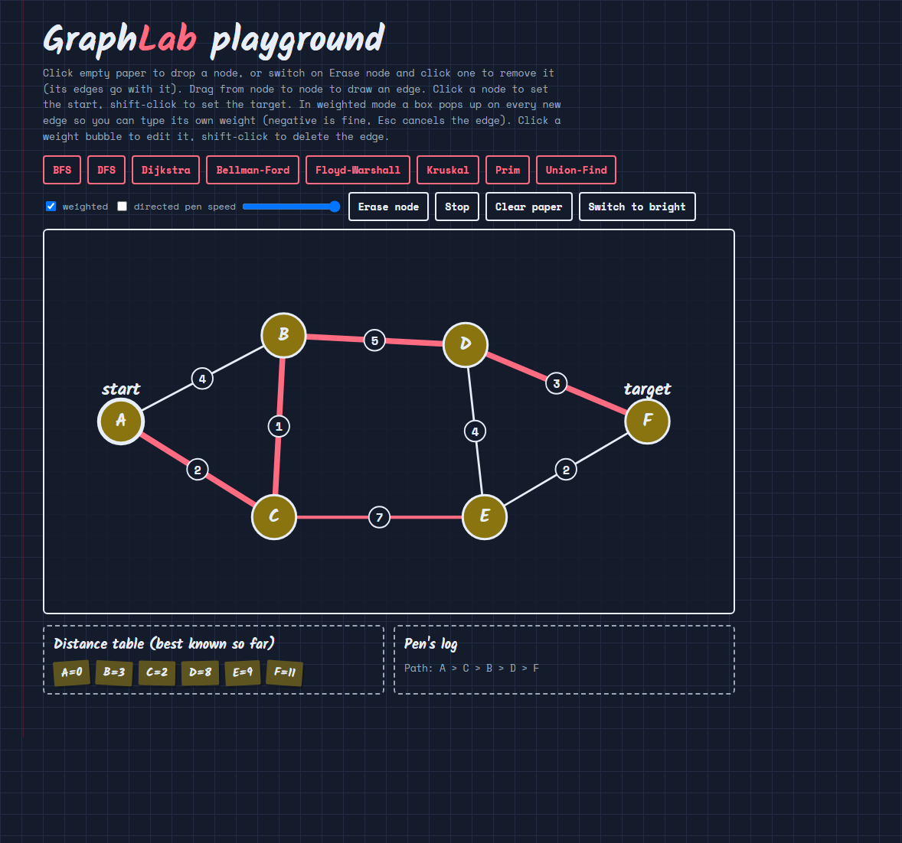

---

### 3.4 Bellman-Ford
- **What it does:** Computes shortest paths from a single source even when edge weights are negative, and detects reachable negative weight cycles.
- **Required settings:** Set **start** and **target**. Supports negative weights.
- **Execution steps:** Click the **Bellman-Ford** button.
- **Visual indicators:**
  - Evaluates $|V| - 1$ relaxation passes across all edges.
  - Settled paths are highlighted upon convergence.
- **Reading panels:**
  - **Notes panel:** "Distances after each pass" shows updated distance estimates for each vertex.
  - **Pen's log:** Reports progress per pass (e.g., "Pass 1: some distances improved", "Pass 4: nothing changed, finished early").
  - If a negative cycle exists, reports: `Negative cycle found, so shortest paths are undefined.`
- **Reference Graph Example:**
  - Start `A`, Target `F`.
  - Distances: `A=0, C=2, B=3, D=8, E=9, F=11`.
  - Output path: `Path: A > C > B > D > F` (Cost 11).
  - Screenshot:
    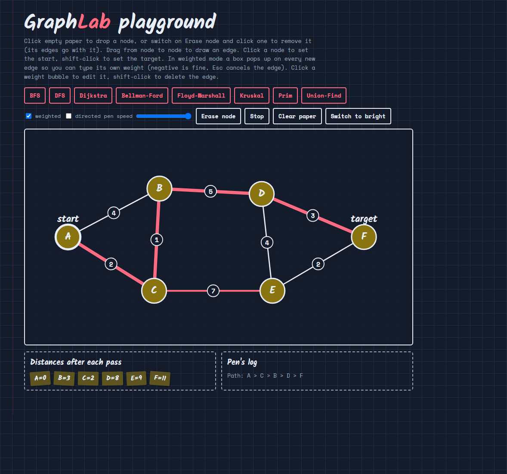

---

### 3.5 Floyd-Warshall
- **What it does:** Computes the shortest paths between all pairs of vertices by systematically allowing each vertex $k$ to act as an intermediate stop-over.
- **Required settings:** Set **start** and **target**. Works on directed or undirected graphs.
- **Execution steps:** Click the **Floyd-Warshall** button.
- **Visual indicators:**
  - Steps through each stop-over vertex $k$ ($0$ to $|V|-1$), highlighting vertex $k$ in bright red.
  - Highlights the final reconstructed path between the selected `start` and `target`.
- **Reading panels:**
  - **Notes panel:** "Distances from start, per stop-over" updates the row of distances from the start node after considering stop-over $k$.
  - **Pen's log:** Displays each stop-over announcement and final path: `Path: A > C > B > D > F`.
- **Reference Graph Example:**
  - Start `A`, Target `F`.
  - Final distance row from `A`: `[0, 3, 2, 8, 9, 11]`.
  - Output path: `Path: A > C > B > D > F` (Cost 11).
  - Screenshot:
    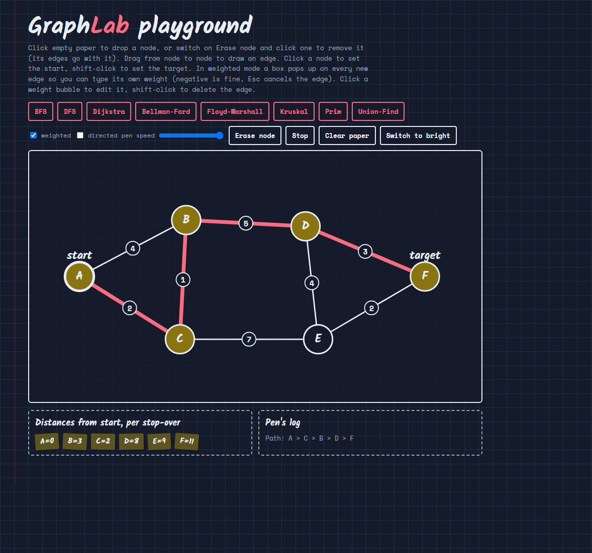

---

### 3.6 Kruskal's Minimum Spanning Tree (MST)
- **What it does:** Finds a minimum spanning forest by sorting all edges by weight and greedily adding edges that do not form a cycle (using Union-Find).
- **Required settings:** Ensure graph has edges. Edges are treated as undirected.
- **Execution steps:** Click the **Kruskal** button.
- **Visual indicators:**
  - The edge currently being evaluated is pulsed.
  - Accepted tree edges are highlighted in solid red (`.e.t`).
  - Rejected cycle edges are rendered in dashed gray (`.e.x`).
  - Connected components are dynamically color-coded by group.
- **Reading panels:**
  - **Notes panel:** "Groups (union-find sets)" shows sets of nodes merged so far (e.g., `{ABCDEF}`).
  - **Pen's log:** Traces each edge decision and outputs: `Minimum spanning forest: 5 edges, total weight 13. Edges treated as undirected.`
- **Reference Graph Example:**
  - Sorted edge decisions:
    1. `B-C (1)`: joins two groups, keep it.
    2. `A-C (2)`: joins two groups, keep it.
    3. `E-F (2)`: joins two groups, keep it.
    4. `D-F (3)`: joins two groups, keep it.
    5. `D-E (4)`: already connected, skip it.
    6. `A-B (4)`: already connected, skip it.
    7. `B-D (5)`: joins two groups, keep it.
    8. `C-E (7)`: already connected, skip it.
  - Final MST: 5 edges (`B-C`, `A-C`, `E-F`, `D-F`, `B-D`), Total weight: **13**.
  - Screenshot:
    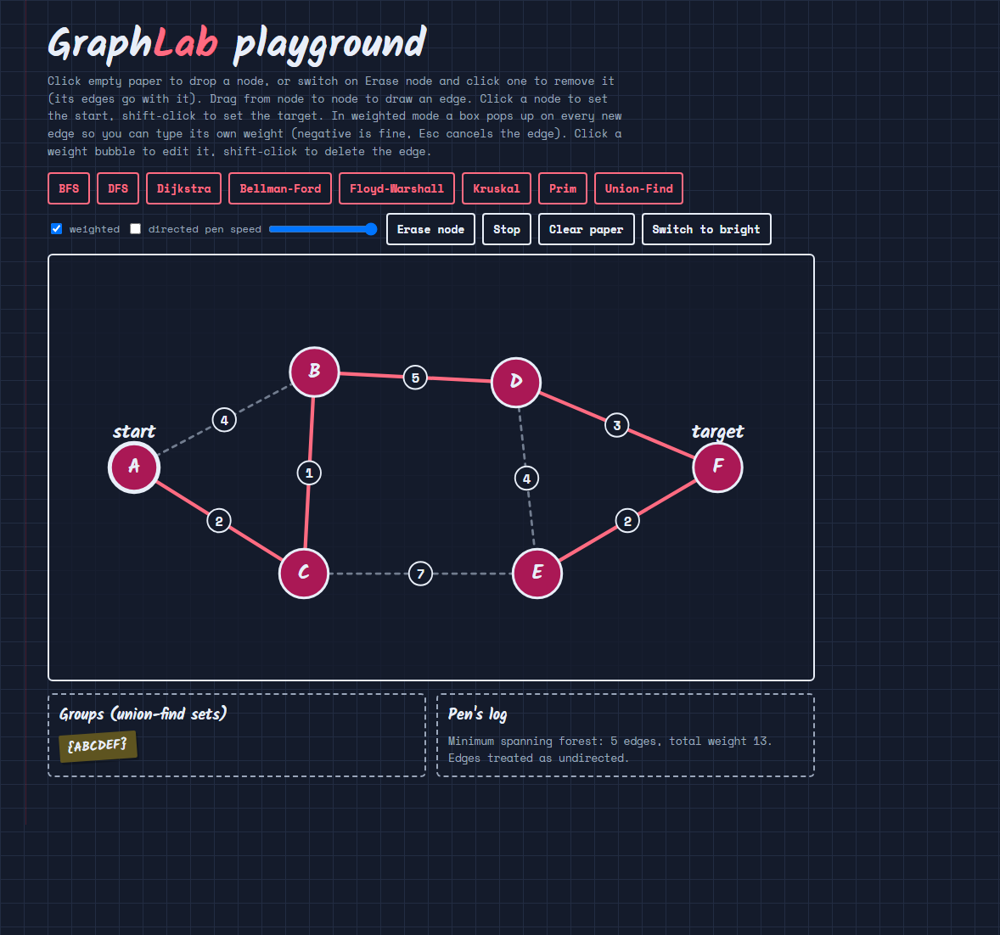

---

### 3.7 Prim's Minimum Spanning Tree
- **What it does:** Grows a minimum spanning tree outward from the start node by greedily picking the cheapest edge crossing the cut between the tree and unvisited nodes.
- **Required settings:** Set **start** node. Edges are treated as undirected.
- **Execution steps:** Click the **Prim** button.
- **Visual indicators:**
  - Nodes inside the growing tree are highlighted in yellow.
  - Selected tree edges are drawn in solid red.
  - Candidate crossing edges leaving the tree are tracked.
- **Reading panels:**
  - **Notes panel:** "Edges crossing the cut" lists edges currently spanning the frontier with their weights.
  - **Pen's log:** Displays each edge selected and the final result: `Spanning tree from A: 5 edges, total weight 13. Edges treated as undirected.`
- **Reference Graph Example:**
  - Start `A`.
  - Added edges: `A-C (2)`, `B-C (1)`, `B-D (5)`, `D-F (3)`, `E-F (2)`.
  - Total edges: 5. Total weight: **13**.
  - Screenshot:
    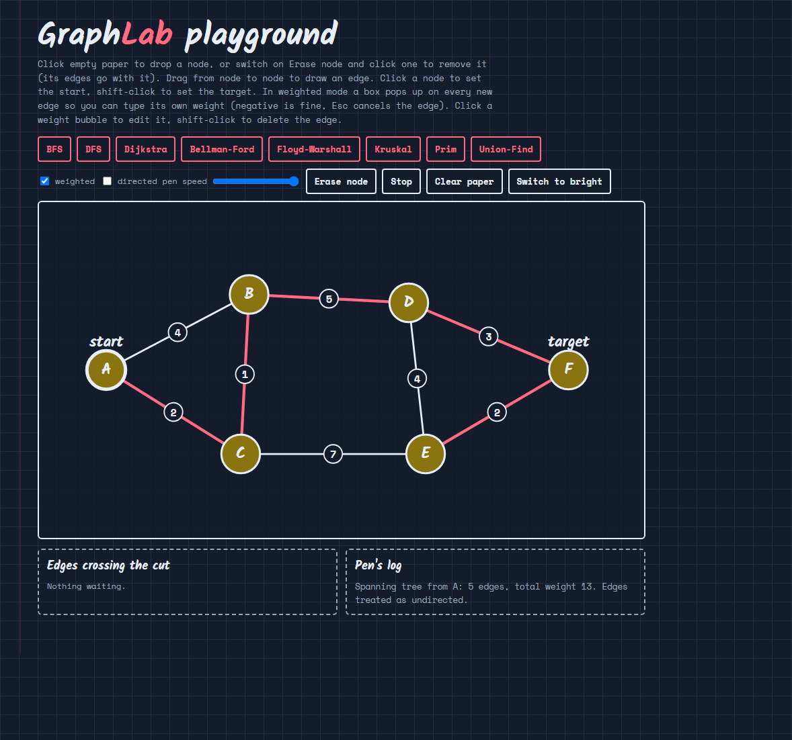

---

### 3.8 Union-Find (Disjoint Set Union)
- **What it does:** Demonstrates incremental set merging across edges and identifies the connected components of the graph.
- **Required settings:** Graph with nodes and edges.
- **Execution steps:** Click the **Union-Find** button.
- **Visual indicators:**
  - Each node is tinted with a distinct hue corresponding to its component ID.
  - When two groups merge, their node colors unite into the root component's color.
- **Reading panels:**
  - **Notes panel:** Displays active partition groups (e.g. `{ABCDEF}`).
  - **Pen's log:** Logs each `union(u, v)` operation and reports the total connected groups: `1 connected group(s). Colors show the groups.`
- **Reference Graph Example:**
  - Merges edges sequentially; after all edges are processed, all 6 vertices belong to 1 single component: `{ABCDEF}`.
  - Screenshot:
    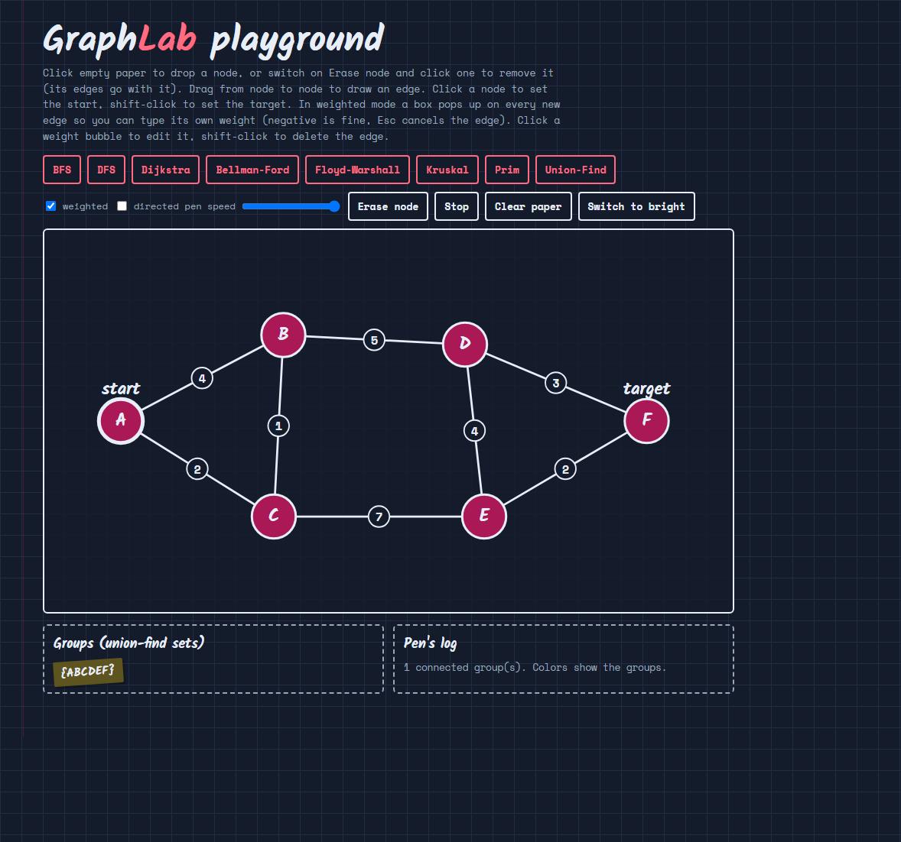

---

## 4. Special Scenarios & Edge Cases

### 4.1 Directed Graphs
When the **directed** checkbox is enabled:
- Edges only permit traversal in the direction of the arrow.
- In the reference graph, `A -> C -> E -> F` has valid forward edges, while `A -> C -> B` is invalid because edge `B -> C` points downward from `B` to `C`.
- Dijkstra and Bellman-Ford find `Path: A > C > E > F` (Cost 11).
- Screenshot:
  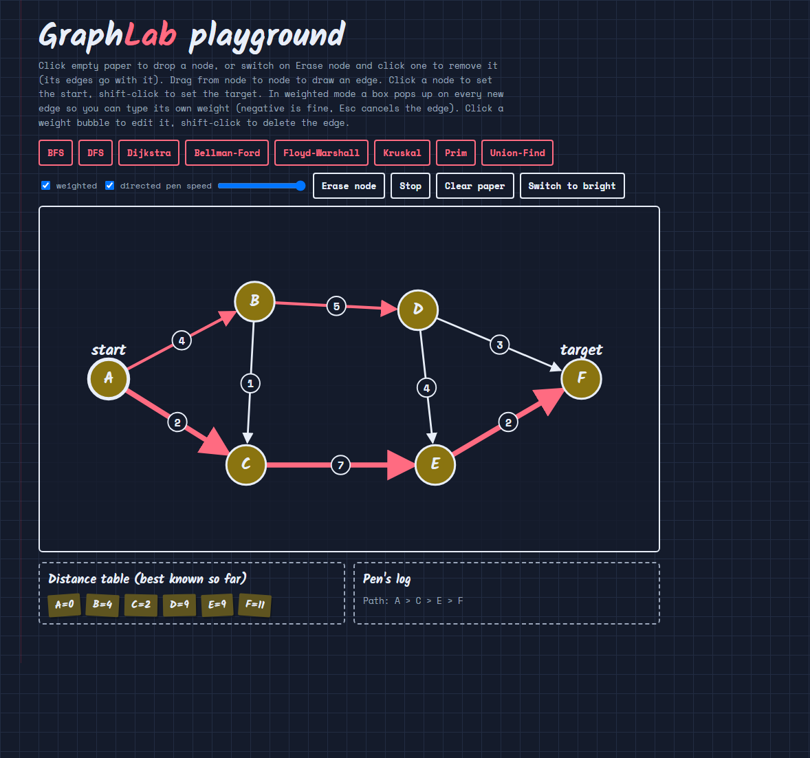

### 4.2 Negative Weights & Dijkstra Safeguard
- Dijkstra **requires non-negative edge weights**. If any edge has a negative weight, running Dijkstra immediately halts and flags the issue in the Pen's log:
  `Dijkstra needs non-negative weights.`
- Use **Bellman-Ford** instead to find shortest paths on graphs with negative edge weights.
- Screenshot:
  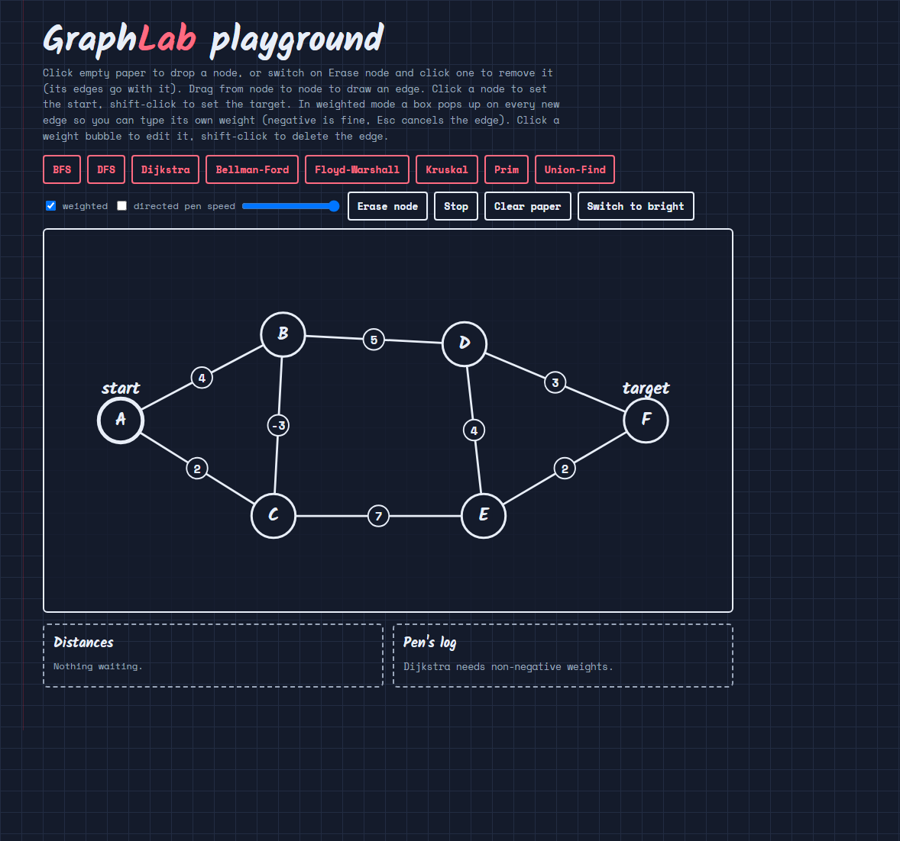

### 4.3 Negative Cycle Detection
- In undirected mode, a negative edge (e.g. `B-C = -3`) forms an instant negative 2-cycle (`B -> C -> B` cost $-6$).
- Bellman-Ford detects that distances continuously improve on pass $|V|$ and safely reports:
  `Negative cycle found, so shortest paths are undefined.`
- Screenshot:
  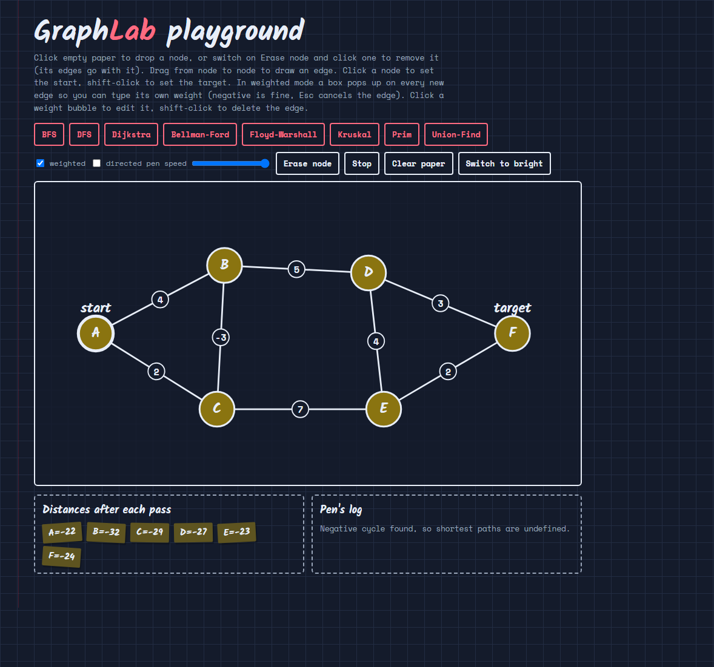

### 4.4 Directed Graphs with Negative Weights (No Cycle)
- On a directed acyclic graph (e.g., `A -> B` weight 4, `B -> C` weight -2, `A -> C` weight 5):
- Bellman-Ford correctly identifies `A -> B -> C` (cost $4 - 2 = 2$) as cheaper than the direct edge `A -> C` (cost 5), outputting `Path: A > B > C`.
- Screenshot:
  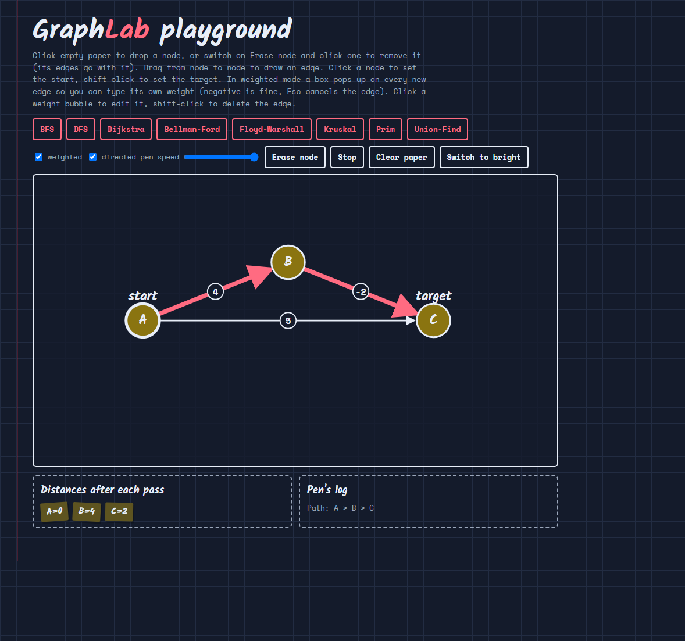

### 4.5 Disconnected Graphs
- If a target node cannot be reached from the start node (e.g., isolated node `G`):
- Dijkstra, Bellman-Ford, BFS, and DFS gracefully report: `G can't be reached from A.`
- No crashes, infinite loops, or undefined errors occur.
- Screenshot:
  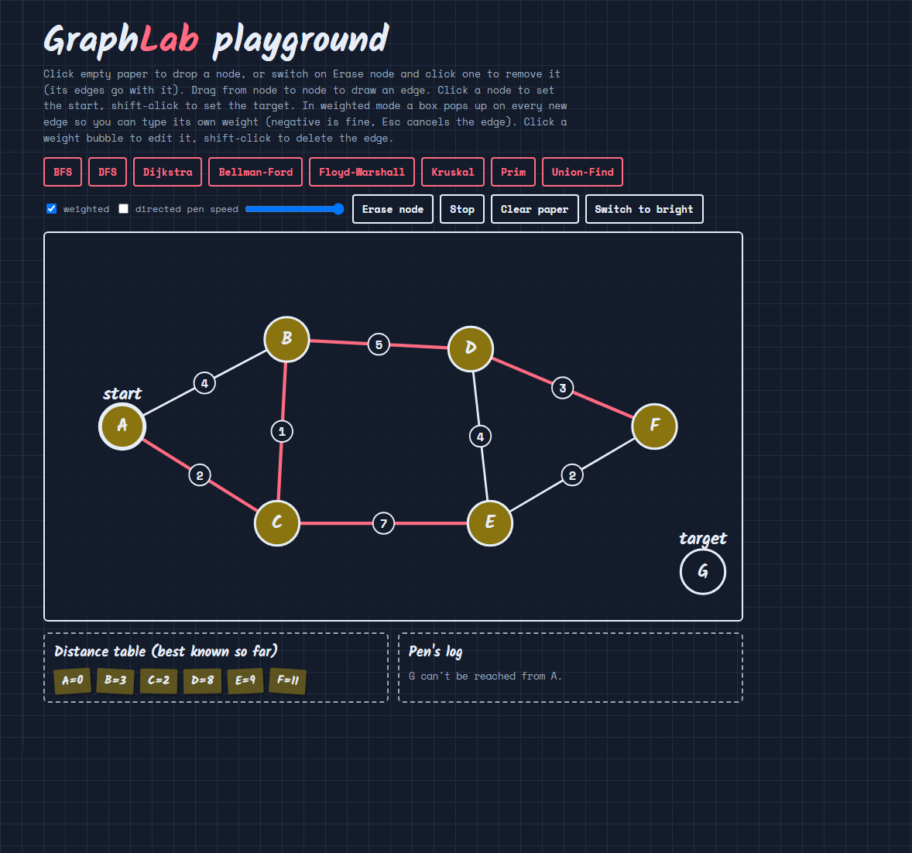

### 4.6 Start Equals Target
- If `start` and `target` are set to the same node (e.g. `start = A`, `target = A`):
- The algorithm reports `Path: A` with node `A` highlighted, with distance 0.
- Screenshot:
  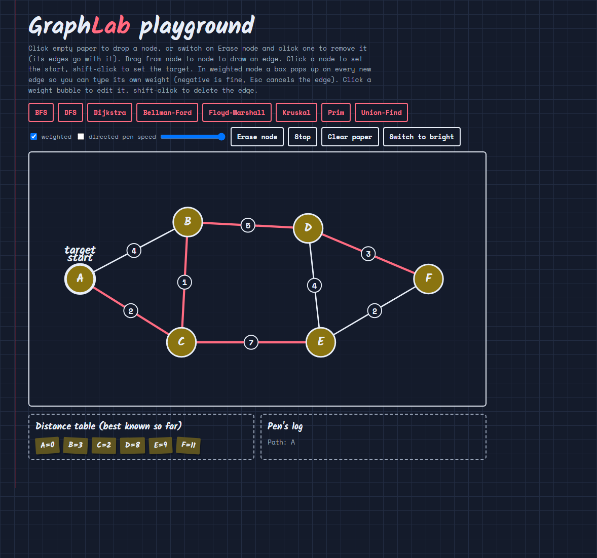

---

## 5. Troubleshooting & FAQ

| Problem | Cause | Solution |
|---|---|---|
| Dijkstra shows "Dijkstra needs non-negative weights." | At least one edge in the graph has a negative weight. | Use the **Bellman-Ford** button, which correctly handles negative edge weights. |
| Bellman-Ford reports "Negative cycle found..." | A cycle whose edge weights sum to less than 0 is reachable from the start node. | Shortest paths to nodes in or downstream of a negative cycle are $-\infty$. Increase the edge weights or remove the negative cycle. |
| Cannot draw an edge between two nodes | An edge already exists between those nodes in that direction. | Click the weight bubble to edit the existing edge's weight, or switch to directed mode if you want opposing directed edges (`A->B` and `B->A`). |
| Clicked canvas but no node appeared | The maximum node capacity is 26 nodes (`A` through `Z`). | Use **Erase node** to remove unused nodes, or click **Clear paper** to start over. |
| Animation is too slow or too fast | Pen speed slider position. | Slide **pen speed** to 10 for near-instant results, or slide to 1 to carefully step through each queue/stack action. |
| Accidental edge created when setting start/target | Dragging mouse instead of clicking. | Single-click without moving the pointer to set start; Shift-click without moving to set target. |
